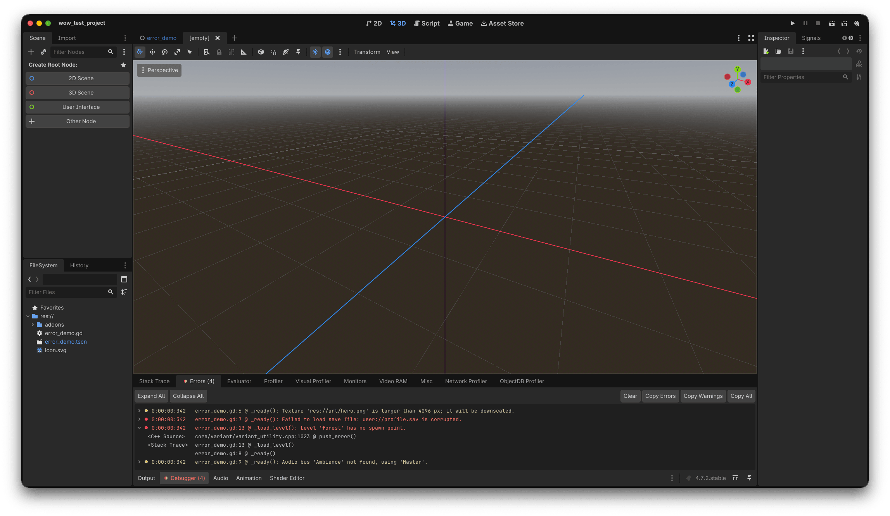

# Copy Errors

[](https://discord.gg/ncKmDEArqg)

A small Godot 4 editor plugin that adds **Copy Errors**, **Copy Warnings** and **Copy All** buttons to the debugger's **Errors** tab.
One click copies every error and warning, with its source and stack trace, to the clipboard as
plain text, ready to paste into an issue, a chat or a log.



## Features

- **Copy Errors**, **Copy Warnings** and **Copy All** buttons next to **Clear** in the Errors tab of every
  debugger session: only the errors, only the warnings, or both.
- Copies errors and warnings in the order shown, each with its details: the script or C++ source,
  the original C++ error and every stack frame.
- Marks each entry with `E` (error) or `W` (warning), like the editor's own **Copy Error** entry.
- Works with several debugger sessions, e.g. when running multiple instances.
- No settings, no runtime code: it only runs in the editor and never ships with your game.

Example of the copied text:

```text
W 0:00:00:376 player.gd:3 @ _ready(): Speed is above the limit.
  <C++ Source> core/variant/variant_utility.cpp:1033 @ push_warning()
  <Stack Trace> player.gd:3 @ _ready()
E 0:00:00:376 level.gd:8 @ load_level(): Level file not found.
  <C++ Source> core/variant/variant_utility.cpp:1023 @ push_error()
  <Stack Trace> level.gd:8 @ load_level()
  main.gd:4 @ _ready()
```

## Installation

### From the Asset Library

1. In the Godot editor, open the **AssetLib** tab and search for **Copy Errors**.
2. Download it and install the `addons/copy_errors` folder.
3. Open **Project > Project Settings > Plugins** and enable **Copy Errors**.

### Manually

1. Download the latest release (or clone this repository).
2. Copy the `addons/copy_errors` folder into your project's `addons/` folder.
3. Open **Project > Project Settings > Plugins** and enable **Copy Errors**.

## Usage

1. Run your project from the editor.
2. Open the **Debugger** panel at the bottom and switch to the **Errors** tab.
3. Click **Copy Errors**, **Copy Warnings** or **Copy All**. The Output panel confirms how many entries were
   copied.

To copy a single entry, use the editor's built-in right-click menu entry **Copy Error**.

## Compatibility

Godot **4.2 or later** (tested with 4.2.2 and 4.7.2). It is written in GDScript and has no native
code.

- It uses the `EditorInterface` singleton, which became available to scripts in Godot 4.2.
- The Errors tab has had the same layout since Godot 4.0. The `E` and `W` markers rely on metadata
  that the editor sets on each entry; without it, entries are copied without a marker.

## How it works

Godot has no scripting API for the debugger's Errors tab, so the plugin finds it in the editor's
own UI. In each debugger session (`ScriptEditorDebugger`) it looks for the tab page that is a
`VBoxContainer` whose first child is the toolbar (`HBoxContainer` with Expand All, Collapse All
and Clear) and which holds the two-column error `Tree`. It matches this layout, not the tab's name,
because the name is translated and gets an error count appended ("Errors (3)").

The buttons read the tree's text column by column: one line per entry and its details indented
below it. The formatting lives in `error_text.gd`, separate from the editor wiring, and is unit
tested.

When the plugin is disabled, it removes its buttons and disconnects its signals.

## Limitations

- It depends on the editor's internal layout. If a future Godot version changes it, the plugin
  prints a warning in the Output panel and does nothing; it never breaks the editor.
- It copies what the Errors tab shows, i.e. errors from the running project. Errors of the editor
  itself appear in the Output panel, which already supports selecting and copying.
- The buttons' text is English only.
- Errors and warnings are told apart by the marks the editor puts on each entry. An entry with neither mark is
  copied only by **Copy All**.
- In headless mode or on platforms without a clipboard, nothing can be copied.

## Development

The repository root is a small Godot project with the plugin enabled; open it in the editor to try
the plugin. Only the `addons/` folder is included in Asset Library and GitHub ZIP downloads.

Run the unit tests headless:

```sh
godot --headless --path . --script tests/run_tests.gd
```

The runner exits with code 1 if a test fails. On Godot 4.5 and later, a script error raised during
a test also fails it. GitHub Actions runs the tests on Godot 4.2.2 and 4.7.2.

## Contributing

Bug reports and pull requests are welcome on
[GitHub](https://github.com/oppahansi/copy_errors/issues). Please:

- describe the Godot version and platform when reporting a bug;
- follow the [GDScript style guide](https://docs.godotengine.org/en/stable/tutorials/scripting/gdscript/gdscript_styleguide.html)
  and use static typing;
- keep the editor free of GDScript warnings;
- add or update tests in `tests/` for formatting changes and run them before opening a pull request;
- use [Conventional Commits](https://www.conventionalcommits.org/) with a scope, e.g.
  `fix(addon): ...` or `docs(readme): ...`.

## License

[MIT](LICENSE) © 2026 oppahansi
